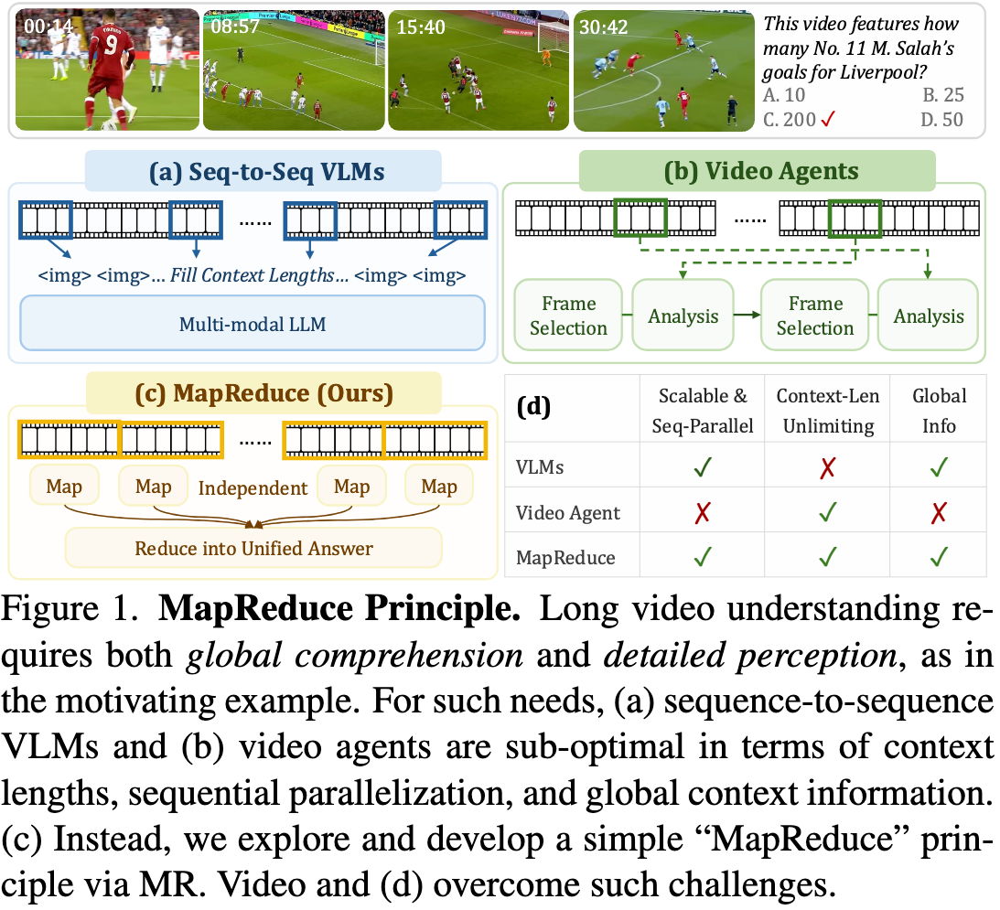

# MR. Video: "MapReduce" is the Principle for Long Video Understanding [NeurIPS 2025]

[Ziqi Pang](https://ziqipang.github.io/), [Yu-Xiong Wang](https://yxw.cs.illinois.edu/)

[[`arXiv`](https://arxiv.org/abs/2504.16082)] [[`Dataset`](https://huggingface.co/datasets/ziqipang/MR-Video)]

[](https://arxiv.org/abs/2504.16082)
[](https://huggingface.co/datasets/ziqipang/MR-Video)
[](LICENSE)

MR. Video is an agentic long-video understanding framework built around a MapReduce pattern: dense short-clip perception followed by global aggregation and reasoning. This repository contains the released code for running the question-answering agent pipeline from precomputed MR. Video captions.



## Code Layout

```text
configs/                 Model/provider configuration.
scripts/                 Dataset runners for LVBench, EgoSchema, and VideoMME.
eval/                    Evaluation scripts for saved predictions.
videoagent/              Core MR. Video agent, prompts, model clients, and video reader.
assets/                  Figures used in this README.
misc/API_KEYS.example.json
```

## Setup

```bash
git clone https://github.com/ziqipang/MR-Video.git
cd MR-Video

python -m venv .venv
source .venv/bin/activate
pip install -r requirements.txt
```

Create an API-key file:

```bash
cp misc/API_KEYS.example.json misc/API_KEYS.json
```

Then edit `misc/API_KEYS.json`:

```json
{
  "openai": "your-openai-api-key",
  "gemini": "your-gemini-api-key"
}
```

You can also skip the JSON file and use environment variables:

```bash
export OPENAI_API_KEY=your-openai-api-key
export GEMINI_API_KEY=your-gemini-api-key
```

## Data Layout

By default, the scripts look for data under `datasets/`. You can either place files there or pass custom paths through command-line arguments or environment variables.

Recommended local layout:

```text
datasets/
  lvbench/
    video_info.meta.jsonl
    videos/
      <lvbench_video>.mp4
      <lvbench_video>.json
    captions/
      <video_id>.json
  egoschema/
    egoschema_val_data.jsonl
    videos/
      <video_id>.mp4
    captions/
      <video_id>.json
  videomme/
    video_mme_long.jsonl
    videos/
      <video_id>.mp4
    captions/
      <video_id>.json
```

Caption files are available from Hugging Face:

- [LVBench Captions](https://huggingface.co/datasets/ziqipang/MR-Video/resolve/main/lvbench_captions.zip)
- [EgoSchema Val Captions](https://huggingface.co/datasets/ziqipang/MR-Video/resolve/main/egoschema_captions.zip)
- [VideoMME Long Captions](https://huggingface.co/datasets/ziqipang/MR-Video/resolve/main/videomme_captions.zip)
- [LongVideoBench Val Long Captions](https://huggingface.co/datasets/ziqipang/MR-Video/resolve/main/longvideobench_captions.zip)

For custom locations, either pass arguments:

```bash
python -m scripts.run_lvbench \
  --lvbench_path /path/to/lvbench/videos \
  --lvbench_meta /path/to/video_info.meta.jsonl \
  --caption_dir /path/to/lvbench_captions
```

or set environment variables:

```bash
export LVBENCH_PATH=/path/to/lvbench/videos
export LVBENCH_META=/path/to/video_info.meta.jsonl
export LVBENCH_CAPTION_DIR=/path/to/lvbench_captions
```

Path overrides used by the runners:

| Benchmark | CLI arguments | Environment variables |
| --- | --- | --- |
| LVBench | `--lvbench_path`, `--lvbench_meta`, `--caption_dir` | `LVBENCH_PATH`, `LVBENCH_META`, `LVBENCH_CAPTION_DIR` |
| EgoSchema | `--egoschema_path`, `--egoschema_meta`, `--caption_dir` | `EGOSCHEMA_PATH`, `EGOSCHEMA_META`, `EGOSCHEMA_CAPTION_DIR` |
| VideoMME | `--videomme_path`, `--videomme_meta`, `--caption_dir` | `VIDEOMME_PATH`, `VIDEOMME_META`, `VIDEOMME_CAPTION_DIR` |

Shared overrides include `MRVIDEO_CONFIG`, `MRVIDEO_API_KEYS`, `MRVIDEO_OUTPUT_DIR`, `MRVIDEO_EXP_NAME`, and `MRVIDEO_LOG_DIR`.

## Smoke Test

Start with one video before launching a full benchmark run:

```bash
python -m scripts.run_lvbench --limit 1 --exp_name smoke_lvbench
```

If you already know a valid video ID, target it directly:

```bash
python -m scripts.run_lvbench --video_ids VIDEO_ID --exp_name smoke_lvbench
```

The same smoke-test flags are available for the other runners:

```bash
python -m scripts.run_egoschema --limit 1 --exp_name smoke_egoschema
python -m scripts.run_videomme --limit 1 --exp_name smoke_videomme
```

## Run Benchmarks

LVBench:

```bash
python -m scripts.run_lvbench --exp_name mrvideo_lvbench
```

EgoSchema:

```bash
python -m scripts.run_egoschema --exp_name mrvideo_egoschema
```

VideoMME:

```bash
python -m scripts.run_videomme --exp_name mrvideo_videomme
```

Useful shared options:

```bash
--config configs/gpt4o_gemini.yaml
--api_key misc/API_KEYS.json
--output_dir data/<benchmark>
--num_processes 4 --process_index 0
```

Outputs are saved as reusable intermediate files:

```text
data/<benchmark>/<exp_name>/<video_id>/
  1_1_user_intention/
  1_2_user_intention/
  2_1_1_goal_proposal/
  2_1_2_perception_results/
  2_2_answer_generation/
```

Re-running the same command resumes from existing intermediate JSON files.

## Evaluate

```bash
python -m eval.lvbench --exp_name mrvideo_lvbench
python -m eval.egoschema --exp_name mrvideo_egoschema
python -m eval.videomme --exp_name mrvideo_videomme
```

If your predictions are outside the default `data/<benchmark>` folder, pass `--output_dir` or set `MRVIDEO_OUTPUT_DIR`.

## Citation

If you find this work useful in your research, please cite:

```bibtex
@article{pang2025mrvideo,
  title={MR. Video: "MapReduce" is the Principle for Long Video Understanding},
  author={Pang, Ziqi and Wang, Yu-Xiong},
  journal={arXiv preprint arXiv:2504.16082},
  year={2025}
}
```
